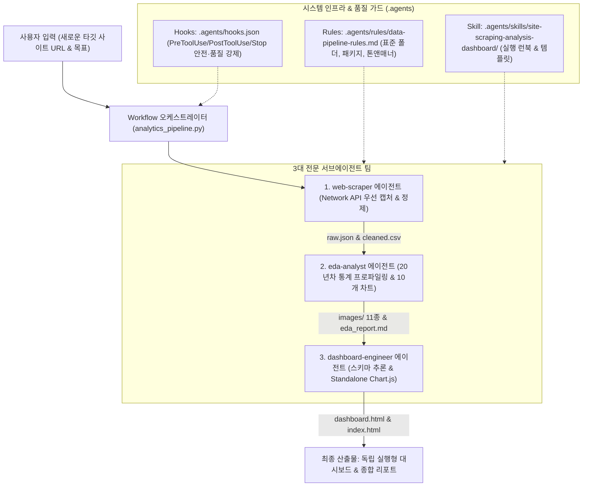
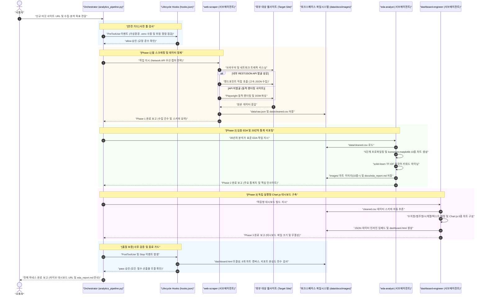

# 🌐 엔드투엔드 웹 크롤링·EDA·대시보드 자동화 시스템 종합 구현 계획서

## [Goal Description]
본 프로젝트는 교보문고 및 YES24 베스트셀러 프로젝트에서 검증된 성공적인 데이터 파이프라인 경험을 바탕으로, **전혀 새로운 웹사이트와 데이터셋에 대해서도 일관된 고품질의 [데이터 수집 ➔ 심층 EDA ➔ 분석 리포트 ➔ Chart.js 웹앱 대시보드 ➔ 배포] 전 과정을 완전 자율적으로 수행할 수 있는 재사용 가능한 커스터마이징 시스템(Rules, Skills, Workflows, Hooks, Agents)**을 설계하고 구축하는 것을 목표로 합니다.

이 시스템을 적용하면 임의의 신규 URL(이커머스, 채용 사이트, 부동산, 뉴스, 커뮤니티 등)을 입력받았을 때 에이전트가 자체적으로 네트워크 API를 분석하여 데이터를 수집·정제하고, 통계학적 무결성이 검증된 10종 이상의 시각화 리포트를 생성하며, 반응형 Chart.js 독립 실행형 웹 대시보드까지 원클릭으로 구축할 수 있습니다.

---

## User Review Required

> [!IMPORTANT]
> **인터뷰 확정 사항 반영**:
> 1. **패키징 위치**: 워크스페이스 표준 구조인 `.agents/` 하위에 `rules`, `skills`, `workflows`, `hooks.json`, `agents`를 직접 배치하여 Antigravity가 즉각적으로 인식하고 활성화하도록 구성합니다.
> 2. **크롤링 전략**: Network API 우선 리버스 엔지니어링 전략(내부 JSON 엔드포인트 캡처 ➔ 미발견 시 Playwright DOM 파싱으로 자동 폴백)을 공식 룰과 스킬 코드로 정형화합니다.
> 3. **EDA & 리포트 표준**: 데이터 프로파일링 5단계, Matplotlib + koreanize-matplotlib 기반 최소 10종 차트, 표 동반, 50자 이상 해석문, TF-IDF 텍스트 마이닝을 의무화하고 `docs/eda_report.md`를 표준 단일 파일로 생성합니다.
> 4. **대시보드 적응형 엔진**: 다양한 도메인 데이터의 수치형/범주형/시계열/텍스트 컬럼을 파이썬 빌더가 자동 감지하여 Chart.js 6종 차트와 KPI를 동적 매핑하는 스키마 추론 템플릿 엔진을 제공합니다.
> 5. **전주기 라이프사이클 훅**: 가상환경 위반 차단(`PreToolUse`), 대시보드 HTML 무결성 검사(`PostToolUse`), 리포트 미완성 시 조기 종료 방지(`Stop`)를 자동 강제합니다.
> 6. **서브에이전트 & 워크플로우**: 3대 전문 서브에이전트(`web-scraper`, `eda-analyst`, `dashboard-engineer`)와 이를 총괄하는 오케스트레이션 워크플로우 스크립트를 구현합니다.

---

## Open Questions

> [!NOTE]
> 인터뷰를 통해 6대 주요 기술 사양이 모두 확정되었으므로, 승인 시 즉시 파일 생성 및 검증 단계로 착수합니다.

---

## Proposed Changes

그룹별 컴포넌트 파일 생성 명세:

### 1. 룰 (Workspace Rules)

#### [NEW] `.agents/rules/data-pipeline-rules.md`
- **트리거**: `model_decision` (웹 스크래핑, 데이터 분석, EDA, 리포트, 대시보드 작업 시 활성화)
- **규정 내용**:
  1. **프로젝트 디렉토리 원칙**: 신규 프로젝트 폴더 생성 시 즉시 `data/`, `docs/`, `images/`, `src/` 4개 하위 폴더 생성.
  2. **환경 원칙**: 워크스페이스 루트의 단일 `.venv` 및 `uv` 필수 사용, 워크스페이스 내 상대경로 엄수.
  3. **스크래핑 철칙**: 브라우저 DOM 파싱 전 반드시 Network API 엔드포인트 존재 여부를 먼저 조사. 수집 데이터는 `*_raw.json` 및 `*_cleaned.csv`로 분리 저장.
  4. **EDA 및 시각화 철칙**:
     - 20년차 베테랑 분석가 한국어 톤앤매너.
     - 필수 프로파일링 5단계 (`head/tail`, `info`, `shape`, `duplicates`, `describe`).
     - `koreanize-matplotlib` 필수, `seaborn` 테마/스타일 설정 금지.
     - 최소 10개 이상의 다각도 시각화 이미지 생성 (`images/` 보관).
     - 모든 시각화마다 50자 이상의 비즈니스 해석문 및 통계표(Table) 동반.
     - scikit-learn `TfidfVectorizer` 기반 핵심 키워드 상위 20~30개 텍스트 마이닝.
     - 단일 마크다운 리포트 `docs/eda_report.md` 작성.
  5. **대시보드 원칙**: Chart.js v4 + Tailwind CSS 기반 단일 HTML (`dashboard.html`), 데이터 인라인 주입(CORS 회피), 4대 KPI 카드, 6종 차트, 실시간 다차원 필터, UTF-8 BOM CSV 다운로드.

---

### 2. 스킬 (Skills & Reusable Templates)

#### [NEW] `.agents/skills/site-scraping-analysis-dashboard/SKILL.md`
- 스킬 메인 가이드 (YAML frontmatter: `name: site-scraping-analysis-dashboard`, `description: 임의의 새로운 웹사이트를 입력받아 네트워크 API 리버스 엔지니어링 스크래핑, 데이터 정제, 20년차 분석가 수준의 심층 EDA, 마크다운 리포트, 그리고 Chart.js 기반 인터랙티브 Standalone 웹앱 대시보드까지 원스톱으로 구축하는 엔드투엔드 파이프라인 스킬입니다.`)
- 4단계 실행 런북(Step-by-step Runbook) 상세 기술.

#### [NEW] `.agents/skills/site-scraping-analysis-dashboard/scripts/template_scraper.py`
- Playwright 네트워크 요청 리스너 및 REST API 캡처 헬퍼 클래스.
- JSON 파싱, 결측치 정제, 표준 CSV 변환 파이프라인 템플릿.

#### [NEW] `.agents/skills/site-scraping-analysis-dashboard/scripts/template_eda.py`
- 데이터 프로파일링 5단계 자동 실행기.
- 수치형/범주형 자동 분류 및 10종 표준 Matplotlib 차트 자동 렌더링 엔진.
- TF-IDF 한국어 불용어 처리 및 키워드 추출기.

#### [NEW] `.agents/skills/site-scraping-analysis-dashboard/scripts/template_build_dashboard.py`
- 자동 데이터 스키마 추론기 (컬럼별 타입 및 카디널리티 분석).
- 데이터 JSON 직렬화 및 HTML 템플릿 인라인 임베드 빌더.

#### [NEW] `.agents/skills/site-scraping-analysis-dashboard/resources/dashboard_template.html`
- Chart.js v4 + Tailwind CSS 기반 미니멀 화이트 범용 대시보드 골격 템플릿.
- 동적 필터, 6대 차트 캔버스, 정렬/페이지네이션 테이블, UTF-8 BOM CSV 익스포트 자바스크립트 모듈 내장.

---

### 3. 워크플로우 (Workflows)

#### [NEW] `.agents/workflows/analytics_pipeline.py`
- `run_workflow` 도구 및 독립 파이썬 인터프리터에서 실행 가능한 오케스트레이터 스크립트.
- 4개 Phase 순차 실행 및 의존성 제어:
  - Phase 1: `Site-Discovery-and-Scraping`
  - Phase 2: `Data-Profiling-and-EDA`
  - Phase 3: `Dashboard-Build`
  - Phase 4: `Verification-and-Summary`

#### [NEW] `.agents/workflows/analytics_pipeline.json`
- 워크플로우 매니페스트 및 입력 인수 스키마 (`target_url`, `project_name`, `keyword_search`, `max_items`).

---

### 4. 라이프사이클 훅 (Hooks)

#### [NEW] `.agents/hooks.json`
- **`PreToolUse` 핸들러 (`env-guard`)**:
  - `matcher: "run_command"`
  - `conda create`, `python -m venv`, `virtualenv`, `pip install` 명령 실행을 차단하고 워크스페이스 공통 `.venv` 및 `uv add`를 사용하도록 자동 안내.
- **`PostToolUse` 핸들러 (`quality-validator`)**:
  - `matcher: "run_command"`
  - 대시보드 빌드 스크립트 실행 후 `dashboard.html` 파일 존재 및 479건(또는 수집건수) 데이터 무결성을 검증하는 파이썬 스크립트 호출.
- **`Stop` 핸들러 (`goal-completion-guard`)**:
  - 프로젝트 내에 `data/*.csv`, `docs/eda_report.md`, `dashboard.html`이 누락된 상태에서 에이전트가 종료하려 할 때 `"decision": "continue"`로 루프 복귀 및 잔여 작업 완수 유도.

#### [NEW] `.agents/hooks/scripts/env_guard.py`
- `PreToolUse` stdin 파싱 및 가상환경 위반 감지 스크립트.

#### [NEW] `.agents/hooks/scripts/post_validator.py`
- `PostToolUse` 산출물 무결성 검증 스크립트.

#### [NEW] `.agents/hooks/scripts/stop_guard.py`
- `Stop` 조기 종료 방지 및 필수 산출물 점검 스크립트.

---

### 5. 전문 서브에이전트 (Agents)

#### [NEW] `.agents/agents/web-scraper.md`
- **역할**: 웹 스크래핑 & API 리버스 엔지니어링 수석 엔지니어
- **프롬프트**: 네트워크 탭 API 우선 캡처, 스크래퍼 작성, `raw.json` 및 `cleaned.csv` 정제 전문 지침.

#### [NEW] `.agents/agents/eda-analyst.md`
- **역할**: 20년차 베테랑 비즈니스 통계 분석가
- **프롬프트**: 프로파일링 5단계, 10종 차트, 표 동반, 50자 해석, TF-IDF 텍스트 마이닝, `eda_report.md` 작성 지침.

#### [NEW] `.agents/agents/dashboard-engineer.md`
- **역할**: Chart.js 기반 Standalone 웹앱 프론트엔드 수석 아키텍트
- **프롬프트**: 스키마 추론, 미니멀 화이트 UI, Chart.js 6종 차트, 인라인 데이터 주입, CSV 익스포트 빌드 지침.

---

## Verification Plan

### Automated Tests
1. **커스터마이징 구조 및 문법 정합성 검증**:
   - `hooks.json` 유효성 검증 (`json.loads()`)
   - 훅 스크립트 문법 검사 (`python -m py_compile .agents/hooks/scripts/*.py`)
   - 템플릿 스크립트 문법 검사 (`python -m py_compile .agents/skills/site-scraping-analysis-dashboard/scripts/*.py`)
   - 워크플로우 스크립트 문법 검사 (`python -m py_compile .agents/workflows/analytics_pipeline.py`)
2. **시뮬레이션 드라이런(Dry-run) 검증**:
   - 더미 데이터셋(예: 가상 이커머스 CSV 100건)을 대상으로 `template_eda.py` 및 `template_build_dashboard.py`를 실행하여 10개 차트와 `dashboard.html`이 오류 없이 생성되는지 확인.
3. **훅(Hook) 동작 검증**:
   - `env_guard.py`에 가상 `conda` 명령 페이로드를 전달하여 `"decision": "deny"` 반환 확인.
   - `quality-validator`가 파일 무결성을 올바르게 통과시키는지 확인.

### Manual Verification
1. `.agents/rules/data-pipeline-rules.md`가 Antigravity에 올바르게 로드되는지 확인.
2. 새 프로젝트 폴더 시나리오에서 `define_subagent` 도구로 등록된 에이전트들이 정상 조회되는지 확인.
3. 생성된 `dashboard_template.html` 기반 대시보드를 로컬 브라우저에서 열어 Chart.js 렌더링 및 필터링 인터랙션 확인.

---

## 7. 전체 하네스 시스템 시퀀스 다이어그램 (End-to-End Sequence Diagram)

아래 시퀀스 다이어그램은 사용자가 새로운 타깃 사이트 URL을 전달했을 때, 워크플로우 오케스트레이터와 3대 전문 서브에이전트, 라이프사이클 훅이 어떻게 유기적으로 협력하여 최종 대시보드와 리포트를 완성하는지 보여줍니다.

---

## 8. 하네스 고도화 및 5대 핵심 보완 명세 (Robustness & Scalability Enhancements)

초기 계획서의 잠재적 한계를 극복하고 임의의 복잡한 신규 웹사이트에서도 무결성을 보장하기 위해 인터뷰를 통해 도출된 5대 핵심 강화 메커니즘을 시스템에 추가 반영합니다.

### 8.1 [보완 1] 안티 스크래핑 및 봇 차단 대응 전략 (Anti-Bot Resilience)
- **3단계 지능형 우회 메커니즘**:
  1. **헤더 스푸핑 (Fingerprint Spoofing)**: 실제 브라우저와 동일한 `User-Agent`, `Sec-CH-UA`, `Accept-Language`, `Referer` 헤더 자동 주입.
  2. **요청 지터 (Request Jitter)**: 고정 주기의 기계적 요청을 지양하고 $1.5\text{s} \sim 3.5\text{s}$ 범위의 정규분포 기반 랜덤 지연 적용.
  3. **지수 백오프 재시도 (Exponential Backoff)**: HTTP 429(Too Many Requests) 또는 503 감지 시 $2^n$초 단위로 대기 시간을 늘려 최대 4회 자동 재시도.

### 8.2 [보완 2] 범용 데이터 정제 및 스키마 정규화 엔진 (Universal Data Normalizer)
- **다양한 표기법의 자동 수치화**: 통화 기호(`₩`, `$`, `€`, `¥`), 쉼표, 한글 단위(`만`, `억`), 축약어(`12.5k`)를 감지하여 순수 정수/실수형으로 자동 변환.
- **퍼지 날짜 파서 (Fuzzy Date Parser)**: `2026-10-15`, `2026.10.15`, `2026/10/15` 표준 포맷은 물론, `3일 전`, `2시간 전`, `어제` 등의 상대 시간 표현을 수집 기준 시점 기반의 절대 날짜(`YYYY-MM-DD`)로 자동 정규화.
- **결측치 지능형 대치**: 수치형 컬럼의 이상치 왜곡을 방지하기 위해 중앙값(Median) 대치 또는 IQR 기반 이상치 플래그를 자동 부여하고, 범주형 컬럼은 `미분류/기타`로 안전하게 범주화.

### 8.3 [보완 3] 대용량 데이터(Big Data) 렌더링 성능 최적화 (2-Tier Architecture)
- **차트 데이터 사전 집계 (Pre-Aggregation)**: 수만 건의 대형 데이터셋의 경우, 브라우저가 매번 전체 레코드를 루프 돌지 않도록 파이썬 빌더 단계에서 차트용 집계 매트릭스(도수분포, 카테고리별 통계)를 사전 연산하여 인라인 주입.
- **산점도(Scatter Plot) 표본 샘플링**: Chart.js 캔버스 렉을 방지하기 위해 산점도 데이터 포인트가 1,000건을 초과할 경우 계통 추출법(Systematic Sampling)으로 최대 1,000개 대표 포인트를 샘플링하여 렌더링.
- **테이블 청크 가상화**: 하단 데이터 목록은 페이지네이션(10/25/50건) 기반으로 필요한 DOM 노드만 메모리에 유지하여 DOM 비대화(Bloat) 차단.

### 8.4 [보완 4] 다국어 및 비한국어 텍스트 분석 호환성 (Language-Adaptive Tokenizer)
- **문자셋 비율 자동 감지**: 텍스트 표본의 한글(Hangul) 및 영문(Latin) 문자 비율을 계산하여 토크나이저 모드를 동적 전환.
- **하이브리드 불용어 처리**:
  - 한국어 위주: 자체 구축된 40여 종의 조사/어미 불용어 사전 + 한글 형태소 단위 정규식 적용.
  - 영문 위주: scikit-learn 내장 `english` 표준 불용어 사전 + 영문 단어 정규식(`\b[a-zA-Z]{3,}\b`) 적용.
  - 혼합 텍스트: 한글과 영문 불용어를 합집합으로 결합하고 다국어 토큰화 파이프라인 가동.

### 8.5 [보완 5] 파이프라인 장애 복구력 및 단계별 재개 (File-based Checkpoint Engine)
- **체크포인트 플래그 파일 운영**:
  - Phase 1 완료 ➔ `data/.checkpoint_phase1.json` (수집 완료 타임스탬프 및 해시 기록)
  - Phase 2 완료 ➔ `docs/.checkpoint_phase2.json` (EDA 완료 플래그)
  - Phase 3 완료 ➔ `dashboard.html` 생성 검증 플래그
- **스마트 재개 (Smart Resume)**: 네트워크 단절이나 예외로 파이프라인이 중단된 후 재실행 시, 이미 유효하게 생성된 이전 Phase 산출물을 건너뛰고 실패한 단계부터 즉각 실행을 재개하여 시간 낭비 및 대상 사이트 중복 요청 방지.
- **강제 재실행 플래그**: 전체 단계를 처음부터 완전히 재수행하고자 할 경우 `--force` 플래그 지원.
